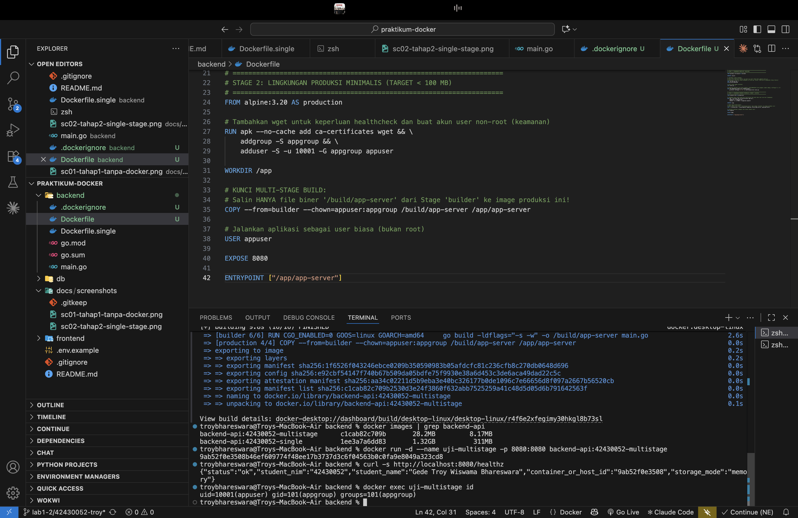

# Laporan Praktikum Modul 1 (Pertemuan 4): Kontainerisasi Docker & Orkestrasi Multi-Tier (Lab 1 & Lab 2)

-   **Nama Mahasiswa**: Gede Troy Wiswama Bhareswara
-   **NIM**: 42430052
-   **Kelas / Prodi**: S1 Teknologi Informasi -- UNDIKNAS Denpasar
-   **Mata Kuliah**: DevOps (MK40)
-   **Branch GitHub**: `lab1-2/42430052-troy`
-   **Tautan Branch / Pull Request GitHub**: *https://github.com/troybhareswara/praktikum-docker/tree/lab1-2/42430052-troy*
-   **Nama Rekan Peer-Reviewer**: *Isi nama dan NIM rekan yang melakukan
    review*

------------------------------------------------------------------------

## 1. Tabel Komparasi Eksperimen Individu (Tahap 1 vs. Tahap 2 vs. Tahap 3)

  -------------------------------------------------------------------------------------------------------------------
  Parameter         Tahap 1: Tanpa Docker (Native di Tahap 2: Docker         Tahap 3: Docker Multi-Stage
  Pembanding        Host OS)                         Single-Stage            (`Dockerfile`)
                                                     (`Dockerfile.single`)   
  ----------------- -------------------------------- ----------------------- ----------------------------------------
  Kebutuhan         Go SDK diperlukan untuk          Tidak perlu Go SDK di   Tidak perlu Go SDK di host untuk
  instalasi Go di   menjalankan `go run main.go`     host untuk menjalankan  menjalankan image
  host                                               image                   

  Ukuran image      Tidak menghasilkan image Docker  **1.32 GB** (ukuran     **28.2 MB** (ukuran image yang teramati)
                                                     image yang teramati)    

  Output identitas  `/healthz` menampilkan identitas `/healthz` menampilkan  `/healthz` menampilkan identitas
                    mahasiswa dan hostname host      identitas mahasiswa dan mahasiswa dan ID container
                                                     ID container            

  User eksekusi     User laptop saat aplikasi        Secara default berjalan `uid=10001(appuser) gid=101(appgroup)`
                    berjalan secara native           sebagai root pada image 
                                                     single-stage            

  Menjalankan       Instansi kedua pada port yang    Dua container dapat     Container dapat dijalankan dengan port
  beberapa instansi sama gagal dengan                dijalankan dengan port  host yang dipetakan ke 8080
                    `bind: address already in use`   host berbeda, misalnya  
                                                     8081 dan 8082           
  -------------------------------------------------------------------------------------------------------------------

### Analisis komparasi

Pada Tahap 1, aplikasi dijalankan langsung di sistem operasi host
menggunakan Go. Endpoint `/healthz` menampilkan hostname laptop karena
proses berjalan pada host. Ketika instansi kedua mencoba menggunakan
port 8080 yang sama, sistem menolak proses tersebut dengan error
`bind: address already in use`.

Pada Tahap 2, aplikasi dikemas menggunakan single-stage Dockerfile
berbasis `golang:1.22-bookworm`. Image yang teramati berukuran 1.32 GB.
Pemetaan port yang berbeda memungkinkan beberapa container menjalankan
aplikasi yang sama secara bersamaan.

Pada Tahap 3, multi-stage build memisahkan proses kompilasi dari image
runtime. Ukuran image turun dari 1.32 GB menjadi 28.2 MB. Pengurangan
ukuran sekitar **97.9%** berdasarkan angka yang ditampilkan oleh
`docker images`. Binary disalin dari stage builder dengan
`COPY --from=builder`, sehingga compiler dan source build tidak ikut
masuk ke image produksi. Layer caching pada `go.mod` dan `go.sum`
membantu menghindari pengunduhan ulang dependensi ketika hanya kode
aplikasi yang berubah. Container dijalankan sebagai user non-root
`appuser` (UID 10001), sehingga hak akses proses lebih terbatas
dibandingkan menjalankan aplikasi sebagai root.

------------------------------------------------------------------------

## 2. Bukti Screenshot & Penjelasan Analisis Setiap Tahapan

### A. Tahap 1 -- Eksekusi Aplikasi Mandiri Tanpa Docker (Baseline)

**Penjelasan Analisis Tahap 1**

Aplikasi dijalankan dengan `go run main.go`. Endpoint `/healthz`
berhasil menampilkan status aplikasi, NIM, nama mahasiswa, hostname
host, dan mode penyimpanan memori. Karena aplikasi berjalan langsung
pada laptop, nilai identitas host menunjukkan hostname laptop. Saat
aplikasi kedua dijalankan pada port 8080 yang sama, proses gagal karena
port tersebut telah digunakan oleh proses pertama.

### B. Tahap 2 -- Kontainer Tunggal dengan Single-Stage Dockerfile

**Penjelasan Analisis Tahap 2**

Aplikasi dikemas menggunakan `backend/Dockerfile.single` dengan base
image `golang:1.22-bookworm`. Image `backend-api:42430052-single`
berhasil dibuat dengan ukuran 1.32 GB. Dua container dapat diuji pada
port host yang berbeda, yaitu 8081 dan 8082, sementara aplikasi di dalam
container tetap mendengarkan port 8080. Ukuran image relatif besar
karena image membawa lingkungan Go yang lengkap, bukan hanya binary
aplikasi.

### C. Tahap 3 -- Optimasi Dockerfile Multi-Stage Build (Target \< 100 MB)

**Penjelasan Analisis Tahap 3**

Image `backend-api:42430052-multistage` berhasil dibangun dengan ukuran
28.2 MB, di bawah target 100 MB pada modul. Dibandingkan image
single-stage 1.32 GB, ukuran turun sekitar 97.9%. Stage `builder`
digunakan untuk mengunduh dependensi dan mengompilasi aplikasi,
sedangkan stage `production` hanya menerima binary melalui
`COPY --from=builder`. Penggunaan `CGO_ENABLED=0` dan flag
`-ldflags="-s -w"` membantu menghasilkan binary mandiri yang lebih
ringkas. Hasil `docker exec uji-multistage id` menunjukkan proses
berjalan sebagai `uid=10001(appuser)`, bukan root.

### D. Tahap 4 (Lab 2 RPS) -- Orkestrasi Multi-Tier & Persistensi Data Database

**Penjelasan Analisis Tahap 4**

Docker Compose digunakan untuk menjalankan tiga layanan: `frontend`
(Nginx), `backend` (Go API), dan `db` (PostgreSQL 16). Browser mengakses
frontend melalui `http://localhost:8080`. Frontend meneruskan permintaan
`/api/` ke layanan backend pada jaringan internal Docker, sedangkan
backend terhubung ke database melalui hostname layanan `db` pada port
5432. Database tidak memiliki pemetaan `ports:` ke host sehingga tidak
diekspos langsung ke luar.

Data PostgreSQL disimpan pada named volume `mk40_pgdata_volume` yang
dipasang pada `/var/lib/postgresql/data`. Setelah `docker compose down`
lalu `docker compose up -d`, container dibuat kembali tetapi named
volume tetap ada. Oleh karena itu, data yang telah disimpan seharusnya
tetap tersedia. Bukti akhir tahap ini adalah data layanan yang
ditambahkan tetap muncul setelah container dibuat ulang.

### E. Tahap 5 -- Skenario Troubleshooting & Analisis Error

**Penjelasan Analisis Tahap 5**

Pengujian dilakukan dengan mengubah sementara `DB_HOST` dari `db`
menjadi `localhost`. Di dalam container backend, `localhost` menunjuk ke
container backend itu sendiri, bukan ke container PostgreSQL. Akibatnya,
koneksi ke port 5432 gagal karena database tidak berjalan di container
backend. Konfigurasi dipulihkan ke `DB_HOST: "db"` dan layanan
dijalankan kembali.

Perintah `docker compose down` menghapus container dan jaringan Compose,
tetapi named volume tetap dipertahankan. Sebaliknya,
`docker compose down -v` juga menghapus named volume yang dikelola
Compose. Jika volume database tersebut dihapus, data PostgreSQL yang
tersimpan di dalamnya dapat hilang.

------------------------------------------------------------------------

## F. Tantangan Mandiri -- Dual Bridge Network, `.env`, dan Healthcheck Backend

**Status dokumentasi:** Belum selesai.

Belum selesai.

------------------------------------------------------------------------

## 3. Bukti Audit Silang (Peer-Review) di GitHub

-   **Tautan Pull Request (PR)**: null
-   **Nama dan NIM Peer-Reviewer**: null
-   **Ringkasan Catatan Peer-Reviewer**: null

------------------------------------------------------------------------

