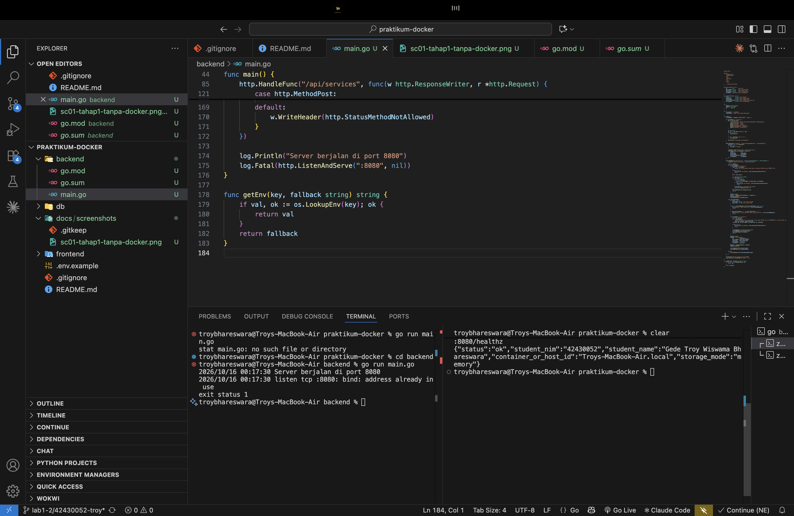
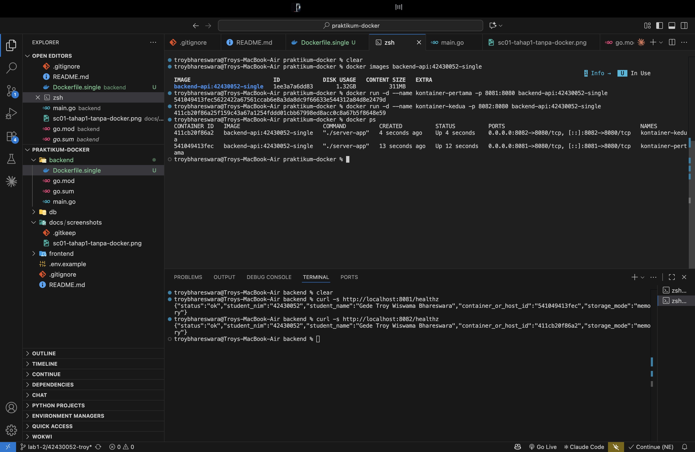
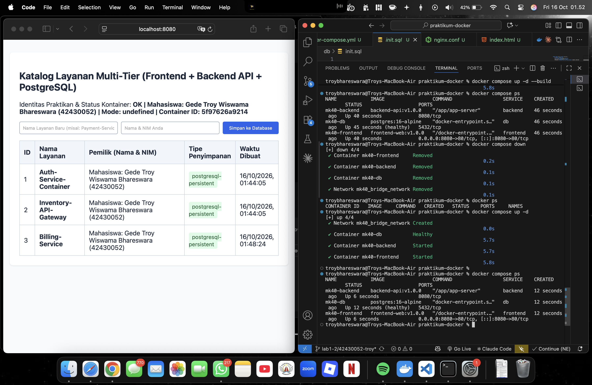
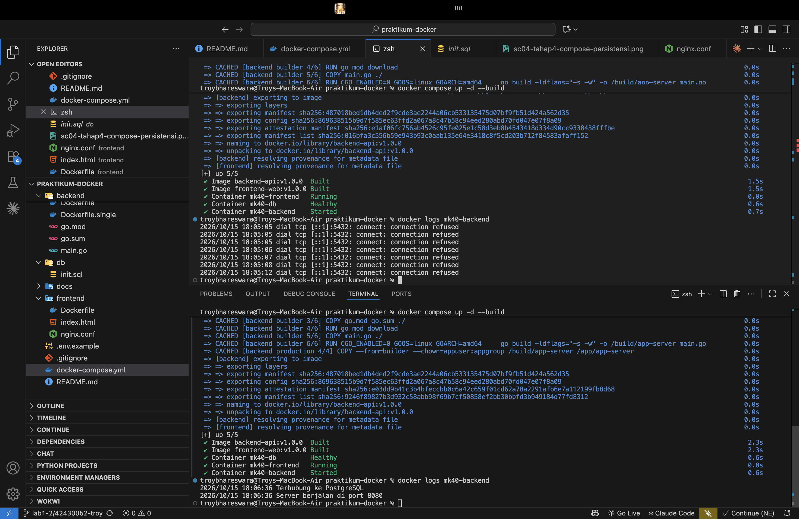
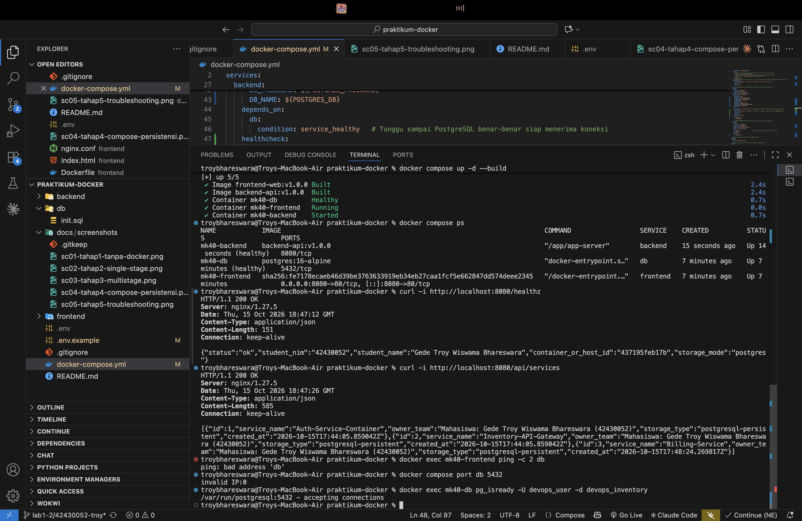

# Laporan Praktikum Modul 1 (Pertemuan 4): Kontainerisasi Docker & Orkestrasi Multi-Tier (Lab 1 & Lab 2)

- **Nama Mahasiswa:** Gede Troy Wiswama Bhareswara
- **NIM:** 42430052
- **Kelas / Prodi:** S1 Teknologi Informasi — Universitas Pendidikan Nasional (UNDIKNAS) Denpasar
- **Mata Kuliah:** DevOps (MK40)
- **Branch GitHub:** `lab1-2/42430052-troy`
- **Repository:** [praktikum-docker](https://github.com/troybhareswara/praktikum-docker)
- **Tautan branch:** [lab1-2/42430052-troy](https://github.com/troybhareswara/praktikum-docker/tree/lab1-2/42430052-troy)
- **Peer-reviewer:** Belum dilakukan; akan dilengkapi setelah review bersama rekan.

---

## 1. Tabel Komparasi Eksperimen Individu (Tahap 1–3)

| Parameter | Tahap 1: Native di Host OS | Tahap 2: Docker Single-Stage | Tahap 3: Docker Multi-Stage |
|---|---|---|---|
| Kebutuhan Go di host | Go SDK diperlukan untuk menjalankan `go run main.go`. | Go SDK tidak diperlukan di host untuk menjalankan container. | Go SDK tidak diperlukan di host untuk menjalankan image hasil build. |
| Ukuran image | Tidak menghasilkan image Docker. | **1.32 GB**, berdasarkan hasil pengukuran. | **28.2 MB**, berdasarkan hasil pengukuran. |
| Output `/healthz` | Menampilkan informasi aplikasi dan hostname host. | Menampilkan informasi aplikasi yang berjalan di container. | Menampilkan informasi aplikasi dan identitas container. |
| User eksekusi | Menggunakan akun host yang menjalankan proses. | Menggunakan user default image single-stage, yaitu root. | Menggunakan user non-root `appuser` dengan UID `10001`. |
| Beberapa instansi | Dua proses tidak dapat memakai port host `8080` secara bersamaan; proses kedua menghasilkan `bind: address already in use`. | Beberapa container dapat berjalan bersamaan dengan port host berbeda, misalnya `8081` dan `8082`. | Image hasil build dapat dijalankan sebagai container dengan pemetaan port sesuai kebutuhan. |
| Hasil utama | Memastikan aplikasi berjalan sebelum dikontainerisasi. | Aplikasi berhasil dikemas, tetapi image masih besar karena lingkungan Go ikut dibawa. | Image jauh lebih kecil dan aplikasi berjalan sebagai user non-root. |

### Analisis komparasi

Pada Tahap 1, aplikasi dijalankan langsung di laptop menggunakan Go. Endpoint `/healthz` berhasil menampilkan status dan informasi aplikasi. Karena aplikasi berjalan di host, hostname yang ditampilkan mengacu pada laptop. Ketika proses kedua mencoba memakai port `8080` yang sudah digunakan, proses tersebut gagal dengan error `bind: address already in use`.

Pada Tahap 2, aplikasi dikemas menggunakan Dockerfile single-stage. Image `backend-api:42430052-single` berhasil dibuat dengan ukuran sekitar **1.32 GB**. Dua container diuji menggunakan port host yang berbeda, yaitu `8081` dan `8082`, sedangkan aplikasi di dalam container tetap mendengarkan port `8080`. Hasil ini menunjukkan bahwa container dapat menjalankan beberapa instansi aplikasi secara terpisah, selama pemetaan port host tidak bentrok.

Pada Tahap 3, proses kompilasi dipisahkan dari image runtime menggunakan multi-stage build. Image `backend-api:42430052-multistage` berukuran **28.2 MB**, atau sekitar **97.9% lebih kecil** daripada image single-stage berdasarkan ukuran yang teramati. Stage `builder` digunakan untuk mengunduh dependensi dan mengompilasi aplikasi, sedangkan stage `production` hanya menyalin binary melalui `COPY --from=builder`. Pengaturan `CGO_ENABLED=0` dan `-ldflags="-s -w"` membantu menghasilkan binary yang lebih ringkas. Pemeriksaan user menunjukkan aplikasi berjalan sebagai `appuser` dengan UID `10001`, bukan root.

---

## 2. Bukti Screenshot dan Analisis Setiap Tahapan

### A. Tahap 1 — Eksekusi Aplikasi Tanpa Docker (Baseline)

**Analisis Tahap 1**

Aplikasi dijalankan menggunakan `go run main.go`. Endpoint `/healthz` berhasil memberikan respons yang memuat status aplikasi, NIM, nama mahasiswa, hostname, dan mode penyimpanan. Karena aplikasi berjalan langsung di laptop, hostname yang ditampilkan merupakan hostname host. Saat aplikasi kedua dijalankan pada port `8080` yang sama, proses kedua gagal karena port tersebut sudah digunakan.

### B. Tahap 2 — Container dengan Single-Stage Dockerfile

**Analisis Tahap 2**

Aplikasi dikemas menggunakan `backend/Dockerfile.single` dengan base image Go. Image `backend-api:42430052-single` berhasil dibuat dengan ukuran **1.32 GB**. Dua container diuji dengan port host yang berbeda, yaitu `8081` dan `8082`, sedangkan aplikasi di dalam container tetap mendengarkan port `8080`. Percobaan ini menunjukkan bahwa container memisahkan lingkungan aplikasi dari host, tetapi ukuran image single-stage masih besar.

### C. Tahap 3 — Optimasi Dockerfile dengan Multi-Stage Build

**Analisis Tahap 3**

Image `backend-api:42430052-multistage` berhasil dibangun dengan ukuran **28.2 MB**, sehingga memenuhi target di bawah 100 MB pada modul. Dibandingkan image single-stage sebesar 1.32 GB, ukurannya turun sekitar **97.9%**. Stage `builder` digunakan untuk mengunduh dependensi dan mengompilasi aplikasi. Stage `production` hanya menerima binary melalui `COPY --from=builder`, sehingga compiler dan source build tidak ikut masuk ke image akhir. Hasil pemeriksaan user menunjukkan proses berjalan sebagai `uid=10001(appuser)`, bukan root.

### D. Tahap 4 (Lab 2 RPS) — Orkestrasi Multi-Tier dan Persistensi Database

**Analisis Tahap 4**

Docker Compose digunakan untuk menjalankan tiga layanan, yaitu `frontend` menggunakan Nginx, `backend` menggunakan Go API, dan `db` menggunakan PostgreSQL 16. Aplikasi dapat diakses melalui `http://localhost:8080`. Frontend meneruskan permintaan `/api/` ke backend melalui jaringan Docker, sedangkan backend mengakses database menggunakan hostname layanan `db` pada port `5432`.

Port PostgreSQL tidak dipublikasikan ke host karena layanan `db` tidak memiliki konfigurasi `ports:`. Database diakses oleh layanan yang membutuhkannya melalui jaringan Docker. Data PostgreSQL disimpan dalam named volume `mk40_pgdata_volume` yang dipasang ke `/var/lib/postgresql/data`. Setelah container dihentikan dan dijalankan kembali, data layanan yang sudah ditambahkan tetap tersedia karena named volume dipertahankan.

### E. Tahap 5 — Troubleshooting dan Analisis Error

**Analisis Tahap 5**

Pada tahap troubleshooting, nilai `DB_HOST` diubah sementara dari `db` menjadi `localhost`. Di dalam container backend, `localhost` menunjuk ke container backend itu sendiri, bukan ke container PostgreSQL. Karena database berada di container terpisah, koneksi ke port `5432` gagal. Setelah pengujian, nilai `DB_HOST` dikembalikan menjadi `db` dan layanan dijalankan kembali.

Percobaan ini menunjukkan bahwa hostname layanan Docker Compose perlu digunakan untuk komunikasi antarkontainer yang berada pada jaringan yang sama. Selain itu, `docker compose down` menghapus container dan jaringan Compose, tetapi named volume tetap dipertahankan. Sebaliknya, `docker compose down -v` dapat menghapus named volume yang dikelola Compose, sehingga data database di dalam volume tersebut dapat hilang.

---

## 3. Tantangan Mandiri — `.env`, Dual Bridge Network, dan Backend Healthcheck

**Status pengerjaan teknis: selesai.** Peer-review bersama rekan masih belum dilakukan dan akan dilengkapi setelah sesi review.

### A. Pemisahan konfigurasi menggunakan `.env`

Konfigurasi database dan identitas mahasiswa dipindahkan ke file `.env`, sedangkan `docker-compose.yml` menggunakan variabel seperti `${POSTGRES_USER}`, `${POSTGRES_PASSWORD}`, `${POSTGRES_DB}`, `${STUDENT_NIM}`, dan `${STUDENT_NAME}`. File `.env` tercantum di `.gitignore`, sehingga tidak muncul pada hasil `git status --short`. File `.env.example` disediakan sebagai contoh variabel yang diperlukan dengan nilai placeholder, bukan password asli.

Perintah `docker compose config --quiet` berhasil dijalankan untuk memvalidasi konfigurasi. Setelah konfigurasi diterapkan, ketiga layanan tetap berjalan.

### B. Pemisahan jaringan menjadi dua bridge network

Jaringan dipisahkan menjadi dua:

- `mk40_frontend_network` menghubungkan `mk40-frontend` dan `mk40-backend`.
- `mk40_backend_network` menghubungkan `mk40-backend` dan `mk40-db`.

Backend terhubung ke kedua jaringan. Frontend tidak terhubung langsung ke jaringan database, sedangkan database tidak terhubung langsung ke jaringan frontend. Hasil `docker network inspect` menunjukkan anggota jaringan sesuai dengan rancangan tersebut. Jaringan lama `mk40_bridge_network` juga sudah tidak ada setelah perubahan diterapkan.

Pemisahan ini membatasi komunikasi antarlayanan berdasarkan kebutuhan. Frontend meneruskan permintaan ke backend, sedangkan backend mengakses PostgreSQL melalui jaringan backend.

### C. Backend healthcheck

Healthcheck ditambahkan pada layanan `backend` di `docker-compose.yml`. Pemeriksaan menggunakan `wget` untuk mengakses endpoint `http://127.0.0.1:8080/healthz`, dengan interval 10 detik, timeout 3 detik, tiga kali percobaan ulang, dan waktu awal 10 detik.

Dockerfile backend sudah menyediakan `wget`, sehingga tidak perlu menambahkan paket tersebut lagi. Setelah konfigurasi diterapkan menggunakan `docker compose up -d --build`, hasil `docker compose ps` menunjukkan backend `Up (healthy)`, database `Up (healthy)`, dan frontend `Up`. Hasil ini menunjukkan bahwa pemeriksaan healthcheck backend berhasil.

### D. Pengujian akhir

Setelah ketiga bagian tantangan diterapkan, layanan Docker Compose berhasil berjalan. Backend dan database terdeteksi sehat, frontend tersedia melalui port host `8080`, dan jaringan baru sesuai dengan konfigurasi Dual Bridge Network. Endpoint `/healthz` dan `/api/services` dapat digunakan untuk memeriksa aplikasi melalui `http://localhost:8080`.

---

## 4. Bukti Audit Silang (Peer-Review) di GitHub

- **Tautan Pull Request (PR):** Belum tersedia; akan dilengkapi setelah proses peer-review.
- **Nama dan NIM peer-reviewer:** Belum dilakukan; akan diisi setelah review bersama rekan.
- **Ringkasan catatan peer-review:** Belum tersedia.

Bagian ini sengaja belum diisi karena review bersama rekan belum dilaksanakan. Setelah sesi peer-review selesai, tambahkan tautan PR, identitas reviewer, dan ringkasan masukan atau perbaikan yang benar-benar diberikan.

---

## 5. Kesimpulan

Dari Tahap 1 sampai Tahap 5, saya berhasil menjalankan aplikasi Go secara native, mengemasnya ke Docker dengan single-stage dan multi-stage build, serta menjalankan frontend, backend, dan PostgreSQL menggunakan Docker Compose. Hasil perbandingan menunjukkan bahwa multi-stage build menurunkan ukuran image dari 1.32 GB menjadi 28.2 MB. Aplikasi pada image multi-stage juga berjalan sebagai user non-root.

Pada Tahap 4, saya mempraktikkan komunikasi antarlayanan, penggunaan named volume untuk mempertahankan data database, dan pembatasan akses langsung ke port PostgreSQL. Pada Tahap 5, saya memahami bahwa `localhost` di dalam container berbeda dengan hostname layanan Docker Compose. Karena itu, backend menggunakan `DB_HOST=db` untuk terhubung ke database.

Pada Tantangan Mandiri, saya berhasil memisahkan konfigurasi ke `.env`, membuat dua bridge network untuk memisahkan jalur komunikasi frontend dan database, serta menambahkan healthcheck pada backend. Hasil pemeriksaan menunjukkan backend dan database berstatus `healthy`. Dengan demikian, pengerjaan teknis Tahap 1–5 dan Tantangan Mandiri telah selesai. Kegiatan yang masih tertunda adalah peer-review bersama rekan dan pengisian bukti review di GitHub.
